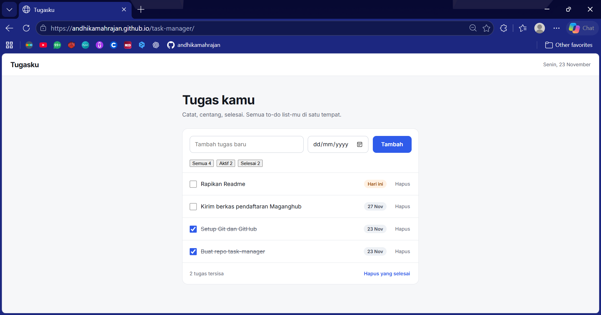
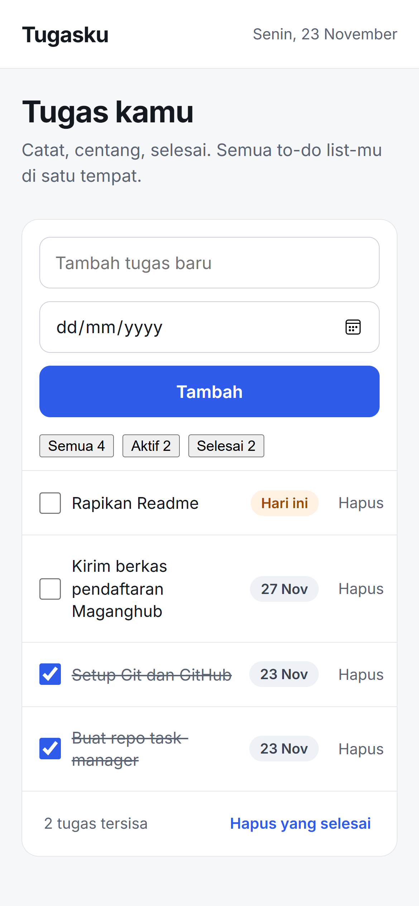

# Tugasku

Aplikasi manajemen tugas sederhana untuk mencatat tugas kuliah dan lamaran. Dibuat dengan HTML, CSS, dan JavaScript murni (tanpa framework) sebagai proyek portofolio software development pertama saya.

**Demo langsung:** https://andhikamahrajan.github.io/task-manager/

## Tampilan





## Fitur

- Tambah tugas dengan tenggat (opsional)
- Centang tugas yang sudah selesai
- Hapus tugas
- Filter Semua, Aktif, dan Selesai, lengkap dengan jumlah di tiap tab
- Penghitung tugas tersisa
- Data tersimpan otomatis di browser (`localStorage`)
- Tampilan responsif untuk desktop dan HP
- Pesan khusus saat belum ada tugas

## Teknologi

- HTML5 dengan elemen semantik
- CSS3: variabel CSS, Flexbox, media query
- JavaScript: manipulasi DOM, event listener, `localStorage`
- Git, GitHub, dan GitHub Pages untuk hosting

## Keputusan teknis

**1. Tugas disimpan sebagai array objek.**
Data dipisah dari tampilan, jadi menambah, menghapus, mencentang, atau memfilter cukup mengubah data, lalu daftar digambar ulang.

**2. Teks dari pengguna dipasang lewat `textContent`, bukan `innerHTML`.**
Supaya kode HTML yang diketik pengguna tampil sebagai teks biasa dan tidak dijalankan.

**3. Tampilan ditata lewat class CSS yang dipasang JavaScript.**
CSS dan JavaScript cukup dihubungkan lewat nama class, tanpa menulis gaya di dalam JavaScript.

**4. Tanggal disimpan dalam format standar (`2026-11-27`) dan diformat saat ditampilkan.**
Penanda "Hari ini" otomatis mengikuti tanggal sebenarnya, dan data gampang diurutkan nanti.

**5. Data disimpan di `localStorage`.**
Aplikasi tidak butuh akun atau server. Kekurangannya, data hanya ada di browser dan perangkat itu. 

**6. `<label>` dihubungkan ke checkbox lewat `for` dan `id`.**
Mengklik tulisan tugas ikut mencentang kotaknya, jadi area klik lebih luas dan nyaman di HP.

## Proses pengerjaan

Proyek ini saya kerjakan dalam beberapa hari sambil belajar HTML, CSS, dan JavaScript dari dasar. Sebelumnya saya baru belajar Python dasar selama sekitar seminggu, jadi ini proyek web pertama saya.

Saya tidak menulis semua kodenya sendiri. Saya dipandu AI (Claude): desain awal dan sebagian besar kode dibuat dengan bantuannya, lalu saya mengetik dan menjalankannya langkah demi langkah, menguji tiap fitur, dan memperbaiki error yang muncul. Beberapa masalah yang saya selesaikan sendiri antara lain error saat `git push`, urutan aturan CSS yang saling menimpa, dan variabel yang dideklarasikan dua kali.

Selama mengerjakannya, saya mencatat alasan di balik tiap keputusan teknis (lihat bagian di atas dan `catatan-keputusan.md`), supaya saya paham kenapa kodenya ditulis seperti itu, bukan hanya menyalinnya. Bagian yang masih ingin saya pelajari lebih dalam: JavaScript tingkat lanjut dan cara kerja backend.

## Menjalankan di komputer sendiri

```bash
git clone https://github.com/andhikamahrajan/task-manager.git
```

Lalu buka `index.html` di browser. Tidak perlu instalasi apa pun.

## Rencana pengembangan

- Edit nama dan tenggat tugas
- Urutkan berdasarkan tenggat
- Mode gelap
- Backend dan akun pengguna agar data bisa dipakai lintas perangkat

## Kontak

Andhika Mahrajan Mahardika · [Email: andhikamahrajan0@gmail.com | LinkedIn: Andhika Mahrajan]